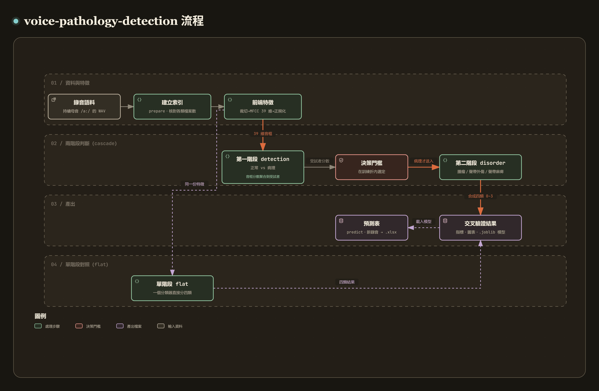

# voice-pathology-detection

[](https://github.com/recklight/voice-pathology-detection/actions/workflows/ci.yml)
[](https://www.python.org/downloads/)
[](LICENSE)

[English](README.md) | 繁體中文

從持續母音 `/a:/` 的錄音偵測病理嗓音，並判別病變類別的研究程式。

這是研究用程式，沒有經過臨床驗證，也不是醫療器材，輸出不能當作診斷依據。

它回答兩個問題：

1. 偵測（第一階段）：這個嗓音是正常還是病理？
2. 病變類別（第二階段）：若為病理，屬於 Neoplasm（腫瘤）、Phonotrauma（聲帶外傷）或 Vocal palsy（聲帶麻痺）中的哪一類？

方法上，先從音檔抽取 13 維梅爾頻率倒頻譜係數（MFCC），串接一階與二階差分成 39 維特徵，做倒頻譜正規化後，以類神經網路逐音框分類，再把音框的分數聚合成每位受試者一個判斷。用倒頻譜向量搭配深度網路偵測病理嗓音的做法，可參考 Fang et al. (2019)。四個類別的定義與 FEMH Voice Data Challenge 2018 的資料集相同（見 [References](#references)）。

MFCC、差分、STFT 頻譜圖、端點偵測與 UAR 這些共用的訊號處理與評估函式都來自 PyPI 上的 [`speechdsp`](https://pypi.org/project/speechdsp/)，這裡不重複實作。

---

## 目錄

- [專案簡介](#專案簡介)
- [方法說明](#方法說明)
- [安裝步驟](#安裝步驟)
- [快速開始](#快速開始)
- [使用範例](#使用範例)
- [CLI 指令對照表](#cli-指令對照表)
- [專案結構](#專案結構)
- [資料準備](#資料準備)
- [設定檔](#設定檔)
- [結果與評估指標](#結果與評估指標)
- [設計重點](#設計重點)
- [開發與測試](#開發與測試)
- [References](#references)

---

## 專案簡介

[](https://raw.githack.com/recklight/voice-pathology-detection/master/docs/workflow.zh-TW.html?theme=dark)

互動式流程圖：[線上瀏覽](https://raw.githack.com/recklight/voice-pathology-detection/master/docs/workflow.zh-TW.html?theme=dark)，或在本機用瀏覽器開啟 [`docs/workflow.zh-TW.html`](docs/workflow.zh-TW.html)。圖可以縮放、搜尋節點，也能追蹤任兩個步驟之間的路徑，例如看某一步的輸入從哪裡來。

粗糙聲、氣息聲、音高不穩與破碎的諧波結構都會反映在短時倒頻譜上，所以整條流程以逐音框的倒頻譜特徵為主，分成七個階段：

| 階段 | 做什麼 | 對應模組 |
| --- | --- | --- |
| 1. 裁切 | 去掉錄音前後的非發聲段落 | `voice_pathology_detection.data.trim` |
| 2. 特徵抽取 | 每 30 ms 音框抽 13 維倒頻譜係數，加上 Δ 與 ΔΔ 成 39 維 | `voice_pathology_detection.features.mfcc` |
| 3. 正規化 | 倒頻譜均值／變異數正規化，統計量只在訓練折上估計 | `voice_pathology_detection.features.normalize` |
| 4. 分類 | 逐音框分類（類神經網路、DBN、SVM、GMM） | `voice_pathology_detection.models` |
| 5. 聚合 | 把音框分數合成每位受試者一個決策 | `voice_pathology_detection.eval.aggregate` |
| 6. 門檻 | 在保留資料上選出操作點 | `voice_pathology_detection.eval.threshold` |
| 7. 評估 | 交叉驗證指標、圖表、預測結果落檔 | `voice_pathology_detection.eval` |

兩條路線可以互相對照：

- `cascade`（兩階段串接）：先偵測，被判為病理者再送進三類分類器，最後合成 0/1/2/3 四類標籤。
- `flat`（單階段四類）：一個分類器直接輸出四類。

兩條路線用同一組折、同一套評估與報表，拆成兩階段到底有沒有好處，可以直接從數字比較。

---

## 方法說明

### 音檔裁切

臨床錄音常在持續母音前後夾雜醫師與病人的對話，這些段落不是發聲，不該進入分析。裁切有兩種做法：

- `fixed_edges`：去頭去尾各 `edge_seconds` 秒，但只對長度超過 `min_seconds` 的錄音動刀，避免短提示音被整段切光。
- `energy_vad`：以短時能量的雙門檻端點偵測（`speechdsp.endpoint_detect`）找出發聲段，不假設錄音一定是某種長度。

裁切後若短於 `min_output_seconds`，這次裁切就不算，保留未裁切的訊號並記一筆警告，參數設錯時才不會把整份錄音切掉。

### 倒頻譜特徵

對每個音框，訊號先經預強調 $y[n] = x[n] - \alpha\,x[n-1]$（$\alpha = 0.97$），加漢明窗，取功率頻譜，再通過 $M = 23$ 個在梅爾刻度上等距的三角濾波器：

$$
m = 1127 \ln\left(1 + \frac{f}{700}\right)
$$

取對數後做離散餘弦轉換，得到倒頻譜係數：

$$
c_k = \sqrt{\frac{2}{M}} \sum_{m=1}^{M} \log(E_m) \cos\left(\frac{k\pi}{M}\left(m - \tfrac{1}{2}\right)\right),
\qquad k = 0, 1, \ldots, 12
$$

再套用正弦倒頻譜提升（cepstral liftering），平衡各階係數的動態範圍：

$$
\hat{c}_k = \left(1 + \frac{L}{2}\sin\frac{\pi k}{L}\right) c_k, \qquad L = 22
$$

輸出遵循 HTK 的 `MFCC_0` 排列：欄位順序為 $[c_1, \ldots, c_{12}, c_0]$，也就是第零階係數放在每個 13 維區塊的最後一欄，而不是第一欄。$c_0$ 採用與其他係數相同的 $\sqrt{2/M}$ 正規化因子；正交（orthonormal）DCT-II 對第零階用的是 $\sqrt{1/M}$，兩者差一個 $\sqrt{2}$，`features/mfcc.py` 裡補上了這個因子。

進入前端之前，訊號先經過一道零相位的 Butterworth 濾波器做頻帶限制，不會引入相位失真。預設 `low_freq: 64`、`high_freq: null`，也就是只有一個 64 Hz 的高通；要關掉高通，在設定檔裡寫 `low_freq: null`。

### 動態特徵

靜態倒頻譜只描述單一個 30 ms 切片，而顫抖、粗糙度隨時間的起伏要看係數怎麼變化。以回歸式差分計算：

$$
d_t = \frac{\sum_{n=1}^{N} n \,(c_{t+n} - c_{t-n})}{2\sum_{n=1}^{N} n^2}
$$

其中 $N = (\text{width} - 1)/2$。一階差分預設視窗寬 7（$N = 3$）；二階（加速度）差分是對一階差分再做一次回歸，而不是對靜態係數取二階差分，預設視窗寬 5（$N = 2$）。邊界以首尾音框複製補足，因此音框數不變。最終特徵排列為：

```
[c1..c12, c0 | Δc1..Δc12, Δc0 | ΔΔc1..ΔΔc12, ΔΔc0]     共 39 維
```

### 倒頻譜正規化

「倒頻譜正規化」底下其實是三種不同的運算，混在一起講，數字就沒辦法互相比較。這裡把它們分開，共六種設定，由 `normalization.method` 選擇：

| `normalization.method` | 運算方式 | 是否有狀態 |
| --- | --- | --- |
| `none` | 不做 | 無 |
| `cvn_block` | 逐音框：把每個 13 維區塊（靜態／一階／二階）各自除以該區塊內係數的標準差 | 無狀態 |
| `cmn` / `cvn` / `cmvn` | 沿時間軸：每個係數各自做零均值／單位變異數 | 有狀態，只在訓練折上 `fit` |
| `cmvn_per_utt` | 同上，但統計量取自每份錄音自己 | 無狀態 |

`cvn_block` 的三個區塊為 `0:13 / 13:26 / 26:39`，除以的是標準差（保持無因次）；要除以變異數，設定 `normalization.divisor: var`。`cmvn` 是文獻上的標準作法，統計量只在訓練折上估計，再原樣套用到驗證與測試折，評估折的統計量不會進到模型裡。

### 分類模型

| 名稱 | 說明 |
| --- | --- |
| `mlp` | sigmoid 多層感知器，SGD + 交叉熵；第一階段預設 5 層 × 200 神經元，第二階段與單階段四類預設 4 層 × 100 |
| `dbn` | 深度信念網路：受限波茲曼機逐層非監督式預訓練，再監督式微調 |
| `torch_dbn` | 同一種網路的 PyTorch 版（選配 extra `dl`），選項比 `dbn` 少，見下文 |
| `svm` | RBF 核支援向量機，含標準化 |
| `linear_svm` | 線性支援向量機 |
| `gmm` | 每類別一個高斯混合模型，以貝氏定理合成後驗機率 |

`dbn` 以受限波茲曼機逐層預訓練：以對比散度（CD-k）訓練，逐層把下層的隱藏層機率當作上層的輸入，訓練完的權重寫進前饋網路的隱藏層，再以反向傳播微調。設定 `pretrain: false` 可在完全相同的拓撲與種子下對照「有預訓練」與「隨機初始化」，直接量測預訓練帶來的差異。

`torch_dbn` 是給大型語料用 GPU 跑的版本，只有 `dbn` 的一部分選項：預訓練固定是一步 Gibbs 取樣的對比散度，微調固定跑 `max_iter` 個 epoch 的 SGD（含 momentum），沒有 early stopping，也沒有 L2 懲罰。它接受 `hidden_layer_sizes`、`pretrain`、`pretrain_epochs`、`pretrain_learning_rate`、`max_iter`、`batch_size`、`learning_rate_init`、`momentum` 與 `device`；`cd_steps`、`update`、`alpha`、`early_stopping` 這些 `dbn` 專有的參數會直接報錯，所以 `configs/dbn_pretrained.yaml` 要先刪掉這些鍵，才能把模型名稱換成 `torch_dbn`。

`dbn` 也可以把對比散度的梯度步換成最大熵的更新規則（`update: maxent`）。參數被視為帶高斯先驗（變異數 $\sigma^2$）的最大熵問題的拉格朗日乘子，每一步以牛頓法求解 Chen 與 Rosenfeld (2000) 的高斯先驗更新所給的穩定條件：

$$
f(\gamma) = F\sigma^2 e^{\gamma S} + \gamma + \lambda - \mu\sigma^2 = 0,
\qquad
f'(\gamma) = F S \sigma^2 e^{\gamma S} + 1
$$

其中 $F$ 為模型期望、$\mu$ 為資料期望、$\lambda$ 為現有參數、$S = \sum_i F_i$。導數有閉合形式，牛頓法數次迭代即收斂，所有參數以 NumPy 一次向量化求解。先驗會把大幅的更新往零拉，可以壓住對比散度在前幾個 epoch 的劇烈震盪。

### 音框到受試者的聚合

模型看的是 30 ms 的音框，要回答的卻是一個人的狀況，所以中間需要一步聚合，而選哪條規則會影響結果：

| `aggregation` | 規則 |
| --- | --- |
| `mean_proba` | 對錄音內所有音框的後驗機率取平均，再取最大（預設） |
| `majority_vote` | 統計硬決策票數，取最多票 |
| `ratio_threshold` | 二元任務專用：病理音框比例達到門檻即判為病理 |

預設用平均後驗機率，因為它保留每個音框的信心程度，硬投票只看每一框判給哪一類。

### 決策門檻

門檻在訓練折內部再切出的驗證集上決定，評估折不參與：

- `youden`：最大化 Youden's J，也就是 $\text{sensitivity} + \text{specificity} - 1$，兩類錯誤成本相同時的預設。
- `target_sensitivity` / `target_specificity`：在達到指定靈敏度（或特異度）的門檻中，取另一軸最好的一個。
- `fixed`：直接用設定檔給的數值，用於重現特定設定。

在驗證集上，最低的判陽分數與最高的判陰分數之間，任何一個門檻的結果都相同。這裡取兩者的中點，而不是貼著最低的判陽分數，新受試者的分數稍低一點時仍會被判為病理。門檻比較的對象隨聚合規則而定：`mean_proba` 比的是病理類別的平均後驗機率，`majority_vote` 與 `ratio_threshold` 比的是病理音框的比例。

驗證集的大小由 `split.val_fraction` 決定。實際做法是把訓練折再做一次分組、分層的 k 折，取其中一折，k = round(1 / val_fraction)，所以 0.2 保留五分之一，0.3 保留三分之一，0.4 與 0.5 都是一半，大於 0.5 的值會被拒絕。訓練折裡某一類只有不到 k 組時，k 會降到那個組數，保留的比例就跟著變大。訓練折小到切不出兩類都有的驗證集時，該折退回固定門檻 0.5，並在日誌留下警告。

每一折選出的門檻都會寫進 `metrics.json`，各折差多少可以直接看到。

---

## 安裝步驟

需要 Python 3.10 以上。

```bash
git clone https://github.com/recklight/voice-pathology-detection.git
cd voice-pathology-detection

# 1. 安裝本專案（共用套件 speechdsp 會一併從 PyPI 安裝）
pip install -e .

# 2. 若要開發與執行測試
pip install -e ".[dev]"

# 3. 選配：PyTorch 版的 DBN（沒有它，其餘功能完全不受影響）
pip install -e ".[dl]"
```

主要相依套件：`speechdsp>=0.2.0`、`numpy>=1.24`、`scipy>=1.10`、`scikit-learn>=1.2`、`pandas>=1.5`、`matplotlib>=3.6`、`pyyaml`、`typer`、`joblib`、`openpyxl`。程式碼同時相容 NumPy 1.x 與 2.x：CI 除了用最新版本測試，另有一個 job 以上面這些最低版本跑完整測試。

---

## 快速開始

不需要任何資料，就能把整條流程跑完一次：

```bash
voice-pathology-detection demo --out-dir results/demo
```

這個指令會在暫存資料夾中合成一小批人工母音，跑完兩階段串接，並把設定、指標、預測與圖表寫進 `results/demo/demo-<時間戳>/`。合成資料的數字跟真實嗓音的表現無關，只用來確認整條流程跑得通，而且同一個種子會得到同樣的結果。

有真實資料時：

```bash
# 1. 建立索引，檢查各類別檔案數
voice-pathology-detection prepare --data-root /path/to/corpus

# 2. 跑兩階段串接的交叉驗證
voice-pathology-detection train --route cascade --config configs/detection_dnn.yaml \
    --set paths.data_root=/path/to/corpus

# 3. 對測試集推論，寫出預測表
voice-pathology-detection predict results/cascade-20261008-101500 \
    --set paths.data_root=/path/to/corpus --output predictions.xlsx
```

`prepare` 預設會把各類別的檔案數拿去和參考語料的組成（Normal 50、Neoplasm 40、Phonotrauma 60、Vocal palsy 50）比對，不符只記錄警告；加上 `--strict` 則直接報錯。你的資料集本來就不是這個組成的話，忽略該警告即可，或用 Python API 傳入自己的 `expected_counts`（見 [docs/data-format.md](docs/data-format.md)）。

`predict` 會用結果資料夾裡的 `config.yaml` 當起點，所以通常只要給資料位置。模型是用哪一組 `mfcc` 與 `trim` 設定訓練的，推論時就得用同一組；`--config` 或 `--set` 若改到這兩個區段，會直接報錯並列出不同的鍵。

結果資料夾裡有 `flat.joblib` 就用它，否則讀 `detection.joblib` 與 `disorder.joblib`，偵測器套用訓練時選出的門檻，因此要指向 `--route flat` 或 `--route cascade` 的產出；只跑 `detection` 或 `disorder` 的資料夾少了另一個模型，會得到一則指名缺少哪個檔案的錯誤。預測表有 `File name` 與 `Prediction`（0–3）兩欄，未指定 `--output` 時寫成結果資料夾裡的 `predictions_<split>.xlsx`。

---

## 使用範例

### CLI

```bash
# 查看解析後的完整設定與可用模型
voice-pathology-detection info --config configs/default.yaml

# 只跑第一階段（正常 vs 病理），設成 5 折、換成支援向量機
voice-pathology-detection train --route detection \
    --config configs/detection_dnn.yaml \
    --folds 5 --model svm \
    --set paths.data_root=/path/to/corpus

# 比較單階段四類與兩階段串接
voice-pathology-detection train --route flat    --config configs/flat_dnn.yaml
voice-pathology-detection train --route cascade --config configs/detection_dnn.yaml

# 抽特徵並快取，之後的實驗就不必重算
voice-pathology-detection features --config configs/default.yaml --output cache/train.npz

# 畫窄頻頻譜圖（正常與三種病理的諧波結構對比）
voice-pathology-detection spectrograms normal.wav neoplasm.wav phonotrauma.wav palsy.wav \
    --output results/figures/spectrograms.png
```

`--model` 換掉的是估計器本身。設定檔裡的 `model.params` 是給原本那個模型用的（例如網路的層數），套到支援向量機上會直接出錯，所以 `--model` 會連同參數一起清掉，讓新模型使用自己的預設值。要自己指定參數，就在同一道指令裡加上 `--set <區段>.model.params='{...}'`（區段是 `detection`、`disorder` 或 `flat`），整組參數會被保留；只給單一個鍵，例如 `--set detection.model.params.C=2`，則是加在清空後的參數上。

`--set` 可以覆寫任何一項設定，可重複使用：

```bash
voice-pathology-detection train --route cascade \
    --set normalization.method=cvn_block \
    --set detection.model.params='{"hidden_layer_sizes": [300, 300], "max_iter": 50}' \
    --set detection.threshold_method=target_sensitivity \
    --set detection.target=0.95

# 換模型並自己給參數：--model 不會清掉你明確指定的 params
voice-pathology-detection train --route detection --model dbn \
    --set detection.model.params='{"hidden_layer_sizes": [200, 200], "pretrain": true}'
```

### Python API

```python
from voice_pathology_detection import (
    Config, build_index, extract_corpus, run_cascade, save_run, set_global_seed,
)

# 1. 設定：路徑與超參數都在設定物件裡
cfg = Config.from_yaml("configs/detection_dnn.yaml").override(
    {"paths.data_root": "/path/to/corpus", "split.n_splits": 5, "seed": 0}
)
set_global_seed(cfg.seed)

# 2. 建索引：逐資料夾掃描，並檢查每個類別的檔案數是否符合預期
index = build_index(cfg, strict_counts=True)
print(index[["subject_id", "label_name", "split"]].head())

# 3. 抽特徵：回傳的 FeatureSet 同時保有音框矩陣與「每個音框來自哪份錄音」
features = extract_corpus(index, cfg, cache_dir=cfg.paths.cache_dir)
print(features.X.shape, features.n_files, features.group_sizes.sum())

# 4. 跑兩階段串接的交叉驗證
result = run_cascade(features, cfg)
print(f"四類 UAR = {result.overall_summary['uar']['mean']:.4f} "
      f"± {result.overall_summary['uar']['std']:.4f}")
print(f"偵測靈敏度 = {result.detection_summary['sensitivity']['mean']:.4f}")
print(f"每折選出的門檻：{result.thresholds}")

# 5. 落檔：設定、指標、報表與逐受試者的預測全部寫進同一個資料夾
run_dir = save_run(cfg.paths.results_dir, cfg, result.to_dict(),
                   tables={"predictions": result.predictions})
```

單獨使用前端與正規化：

```python
import numpy as np
from speechdsp import read_wav
from voice_pathology_detection import Config, extract_features, make_normalizer, trim_audio

cfg = Config()
audio, sr = read_wav("subject_001.wav")

trimmed = trim_audio(audio, sr, cfg.trim)          # 去掉非發聲段落
X = extract_features(trimmed.audio, sr, cfg.mfcc)  # (音框數, 39)

normalizer = make_normalizer(cfg.normalization).fit(X)
X_norm = normalizer.transform(X)
print(X.shape, trimmed.duration(sr))
```

自己串一個偵測實驗（接續上面的 `features`）。門檻在訓練折切出的驗證集上選，再拿到評估折上用：

```python
from voice_pathology_detection.data.splits import (
    check_no_group_leakage, subject_folds, train_val_split,
)
from voice_pathology_detection.eval.aggregate import aggregate_frames
from voice_pathology_detection.eval.metrics import evaluate
from voice_pathology_detection.eval.threshold import select_threshold
from voice_pathology_detection.models.registry import build_model
from voice_pathology_detection.routes import binary_view

binary = binary_view(features)                  # 標籤變成 0 = 正常、1 = 病理
folds = subject_folds(binary.files, n_splits=5, seed=0)
check_no_group_leakage(binary.files, folds)     # 同一位受試者不會跨折

fold = folds[0]
fit_rows, val_rows = train_val_split(binary.files, fold.train, val_fraction=0.2, seed=0)
fit_set, val_set, test_set = (binary.select(rows) for rows in (fit_rows, val_rows, fold.test))

model = build_model("gmm", {"n_components": 1}).fit(fit_set.X, fit_set.frame_labels)
val = aggregate_frames(model.predict_proba(val_set.X), val_set.group_sizes, mode="mean_proba")
choice = select_threshold(val_set.file_labels, val.score(1), method="youden")

test = aggregate_frames(model.predict_proba(test_set.X), test_set.group_sizes, mode="mean_proba")
pred = (test.score(1) >= choice.threshold).astype(int)
report = evaluate(test_set.file_labels, pred, test.score(1), level="subject")
```

### 範例腳本

`examples/` 底下兩支腳本完全以合成資料執行，不需要任何錄音：

```bash
python examples/end_to_end_synthetic.py --out-dir results/example
python examples/compare_normalizations.py --out-csv results/comparison.csv
```

前者跑完整條流程並比較兩條路線；後者在完全相同的折與種子上，逐一比較四種正規化設定（`none`、`cvn_block`、`cmvn`、`cmvn_per_utt`）與三種模型，表上每一列只差一個變因。

---

## CLI 指令對照表

| 指令 | 用途 | 常用選項 |
| --- | --- | --- |
| `voice-pathology-detection info` | 顯示解析後的設定、可用模型與類別編碼 | `--config`、`--set` |
| `voice-pathology-detection prepare` | 掃描資料夾建立索引，檢查各類別檔案數 | `--data-root`、`--split`、`--strict`／`--no-strict`、`--output` |
| `voice-pathology-detection features` | 抽取並快取音框特徵矩陣 | `--config`、`--split`、`--output` |
| `voice-pathology-detection train` | 交叉驗證一條路線，輸出指標、圖表與模型 | `--route`、`--folds`、`--model`、`--normalization`、`--run-id` |
| `voice-pathology-detection predict` | 以存下的模型推論新錄音，寫出預測表 | `--data-root`、`--split`、`--output` |
| `voice-pathology-detection spectrograms` | 畫窄頻頻譜圖 | `--n-fft`、`--noverlap`、`--max-freq` |
| `voice-pathology-detection demo` | 以合成音檔跑完整流程，不需資料 | `--per-class`、`--folds`、`--out-dir` |

`--route` 的四個選項：

| 值 | 意義 |
| --- | --- |
| `detection` | 第一階段：正常 vs 病理 |
| `disorder` | 第二階段：三種病變類別（只用病理錄音訓練與評估） |
| `cascade` | 兩階段串接，合成 0/1/2/3 四類最終標籤 |
| `flat` | 單階段四類分類器（對照組） |

---

## 專案結構

```
voice-pathology-detection/
├── README.md
├── README.zh-TW.md                   # 繁體中文版 README
├── LICENSE
├── pyproject.toml
├── configs/                          # 設定檔，實驗參數全部在這裡
│   ├── default.yaml                  # 內建預設值的完整寫法
│   ├── mfcc_30ms.yaml                # 30 ms / 15 ms / 23 mel 的前端設定
│   ├── detection_dnn.yaml            # 第一階段：5 層 × 200
│   ├── disorder_dnn.yaml             # 第二階段：4 層 × 100
│   ├── flat_dnn.yaml                 # 單階段四類：4 層 × 100
│   ├── dbn_pretrained.yaml           # 含 RBM 預訓練的 DBN
│   └── baselines.yaml                # 淺層對照組（SVM、GMM）
├── docs/
│   ├── images/workflow.png           # 英文 README 的流程圖
│   ├── images/workflow.zh-TW.png     # 中文 README 的流程圖
│   ├── workflow.html                 # 互動式流程圖（英文，瀏覽器開啟）
│   ├── workflow.zh-TW.html           # 互動式流程圖（中文）
│   ├── algorithms.md                 # 每個演算法的數學式與參數
│   ├── data-format.md                # 資料格式與標籤編碼
│   └── reproduce.md                  # 如何重現一次實驗
├── examples/
│   ├── end_to_end_synthetic.py       # 合成資料的完整示範
│   └── compare_normalizations.py     # 正規化設定與模型的比較表
├── src/voice_pathology_detection/
│   ├── __init__.py                   # 公開 API 的 re-export
│   ├── config.py                     # 設定物件（dataclass + YAML + 驗證）
│   ├── seed.py                       # 統一設定亂數種子並記錄
│   ├── logging_utils.py              # 記錄設定
│   ├── cli.py                        # typer 命令列介面
│   ├── prediction_table.py           # predict 寫出的預測表（File name / Prediction）
│   ├── data/
│   │   ├── labels.py                 # 類別編碼、名稱、二元映射、檔案數檢查
│   │   ├── dataset.py                # 建立檔案索引（資料夾或標註表）
│   │   ├── trim.py                   # 音檔裁切（fixed_edges / energy_vad）
│   │   ├── splits.py                 # 分組、分層的 k 折交叉驗證
│   │   └── synthetic.py              # 合成母音與合成特徵矩陣
│   ├── features/
│   │   ├── mfcc.py                   # HTK MFCC_0 排列的倒頻譜前端
│   │   ├── deltas.py                 # 回歸式 Δ / ΔΔ 與區塊切分
│   │   ├── normalize.py              # 六種正規化設定（sklearn 介面）
│   │   └── pipeline.py               # FeatureSet：音框、來源與索引的綁定
│   ├── models/
│   │   ├── mlp.py                    # sigmoid 多層感知器
│   │   ├── rbm.py                    # 受限波茲曼機（CD-k / maxent）
│   │   ├── maxent.py                 # 最大熵乘子的牛頓法求解
│   │   ├── dbn.py                    # 逐層預訓練 + 監督式微調
│   │   ├── torch_dbn.py              # 選配的 PyTorch 版本
│   │   ├── svm.py                    # 支援向量機對照組
│   │   ├── gmm.py                    # 高斯混合模型對照組
│   │   └── registry.py               # 由名稱建立模型
│   ├── routes/
│   │   ├── stage.py                  # 共用的訓練與評估迴圈
│   │   ├── detection.py              # 第一階段
│   │   ├── disorder.py               # 第二階段
│   │   ├── cascade.py                # 兩階段串接
│   │   └── flat.py                   # 單階段四類
│   ├── eval/
│   │   ├── aggregate.py              # 音框 → 受試者
│   │   ├── threshold.py              # 門檻選擇與掃描
│   │   ├── metrics.py                # UAR、靈敏度、特異度、PPV/NPV、AUC
│   │   ├── plots.py                  # 混淆矩陣、門檻曲線、ROC、頻譜圖
│   │   └── report.py                 # metrics.json / report.md / config.yaml
│   └── fusion/
│       └── score_fusion.py           # 多系統分數融合（網格搜尋與 stacking）
└── tests/                            # 全部使用程式合成的 fixture
```

---

## 資料準備

套件裡沒有任何錄音，資料請自行準備，再用設定指向它。

### 支援的資料夾結構

#### 方式一：一個診斷一個資料夾（建議）

```
/your/data/root/
├── train/
│   ├── Normal/            001.wav 002.wav ...
│   ├── Neoplasm/          001.wav 002.wav ...
│   ├── Phonotrauma/       001.wav 002.wav ...
│   └── Vocal palsy/       001.wav 002.wav ...
└── test/
    └── *.wav
```

資料夾名稱不分大小寫，`Vocal palsy`、`vocal_palsy`、`VocalPalsy`、`palsy` 都可以被辨識。

#### 方式二：扁平資料夾 + 標註表

```
/your/data/root/
├── train/                 001.wav 002.wav ...
├── test/                  *.wav
└── Demographics.xlsx      欄位：File name / Diagnosis(0-3) / Gender / Age
```

設定 `paths.demographics: Demographics.xlsx` 即可，`.csv` 與 `.tsv` 也可以。表格的欄位名稱會以不分大小寫的別名比對，`File name`、`filename`、`Diagnosis(0-3)`、`label` 等都能辨識。每一格都以文字讀入，`001` 這種檔名會保留前導零，檔名可含或不含副檔名。有錄音在表格中找不到、或診斷欄是空白的，會直接報錯並列出那些檔名，不會靜默跳過。

同一個人有多份錄音時，在表格加一欄 `Subject ID`（或 `Speaker`），再設定 `split.group_by: speaker_id`，同一個人的錄音就會落在同一折，內層驗證集也一樣。表格沒給說話者的錄音自成一組。

### 音檔格式

- WAV 格式，單聲道或多聲道（多聲道會自動平均成單聲道）
- 取樣率請與 `mfcc.sample_rate` 一致；不一致時會記一筆警告，照實際取樣率分析
- 內容為持續母音 `/a:/`
- 長度不限，但短於一個音框（預設 30 ms）或含有 NaN、無限大取樣值的錄音會被跳過，日誌會記下跳過的份數與前三個檔名

### 標籤編碼

| 編碼 | 四類任務 | 二元任務 |
| --- | --- | --- |
| 0 | Normal | Normal |
| 1 | Neoplasm | Pathological |
| 2 | Phonotrauma | Pathological |
| 3 | Vocal palsy | Pathological |

### 指向你的資料

三種方式擇一：

```bash
# a. 命令列參數
voice-pathology-detection train --data-root /your/data/root

# b. --set 覆寫
voice-pathology-detection train --set paths.data_root=/your/data/root

# c. 自己的設定檔
cp configs/default.yaml configs/local.yaml   # 編輯其中的 paths.data_root
voice-pathology-detection train --config configs/local.yaml
```

`data/`、`results/`、`cache/`、`configs/local*.yaml`，以及所有 `*.wav`、`*.npy`、`*.npz`、`*.joblib`、`*.xlsx`、`*.csv`、`*.tsv` 都列在 `.gitignore` 裡：標註表、索引與預測表帶有檔名和診斷，自己的設定檔則帶有本機路徑。

---

## 設定檔

設定是巢狀的 dataclass，載入時會逐項驗證，寫錯的鍵會被指名：

```
ConfigError: unknown configuration key(s): ['mfcc.window_ms'];
valid keys in this section are ['accel_width', 'delta_width', 'frame_ms', ...]
```

主要區段：

| 區段 | 重要欄位 |
| --- | --- |
| `paths` | `data_root`、`train_dir`、`test_dir`、`demographics`、`cache_dir`、`results_dir` |
| `mfcc` | `sample_rate`、`frame_ms`、`hop_ms`、`n_mels`、`n_ceps`、`lifter`、`preemph`、`low_freq`、`high_freq`、`use_deltas`、`delta_width`、`accel_width` |
| `trim` | `mode`、`edge_seconds`、`min_seconds`、`min_output_seconds` |
| `normalization` | `method`、`block_size`、`divisor`、`eps` |
| `split` | `n_splits`、`seed`、`group_by`、`val_fraction` |
| `detection` | `model.name`、`model.params`、`aggregation`、`threshold_method`、`threshold`、`target` |
| `disorder` | `model.name`、`model.params`、`aggregation` |
| `flat` | `model.name`、`model.params`、`aggregation` |
| 頂層 | `seed`、`log_level` |

每條路線讀與自己同名的區段，`cascade` 則讀 `detection` 與 `disorder` 兩個區段。

不帶 `--config` 時用的是內建預設值（`predict` 例外，它從結果資料夾的 `config.yaml` 開始）；`configs/default.yaml` 把同一組值完整寫出來（測試會檢查兩者一致），可以複製一份當作自己設定檔的起點。其他設定檔只寫該實驗用得到的區段，沒寫到的鍵沿用預設值；`seed`、`normalization` 這類區段即使和預設相同也照寫，方便對照。

每次執行都會把實際生效的完整設定寫成 `config.yaml`，存在該次結果資料夾中，所以任何一次實驗都能從自己的產出重跑：

```bash
voice-pathology-detection train --route cascade --config results/cascade-20261008-101500/config.yaml
```

---

## 結果與評估指標

每次執行產生一個資料夾。以 `--route detection` 為例：

```
results/<run_id>/
├── config.yaml              # 實際生效的完整設定
├── metrics.json             # 所有指標（逐折 + 平均 ± 標準差 + 彙總）
├── report.md                # 可讀的摘要報表
├── predictions.csv          # 逐受試者的預測（每人恰好出現一次）
├── folds_subject.csv        # 逐折的受試者層級指標
├── folds_frame.csv          # 逐折的音框層級指標
├── threshold_sweep.csv      # 門檻掃描結果
├── detection.joblib         # 供 predict 使用的模型與門檻
└── figures/
    ├── confusion_subject.png
    ├── confusion_frame.png
    ├── folds_subject.png
    ├── threshold.png
    └── roc.png
```

其中幾項隨路線而異：

| 檔案 | 哪些路線會有 |
| --- | --- |
| `config.yaml`、`metrics.json`、`report.md`、`predictions.csv` | 全部 |
| `folds_subject.csv`、`folds_frame.csv` | `detection`、`disorder`、`flat`；`cascade` 不輸出逐折資料 |
| `figures/confusion_subject.png`、`figures/confusion_frame.png`、`figures/folds_subject.png` | `detection`、`disorder`、`flat` |
| `threshold_sweep.csv`、`figures/threshold.png`、`figures/roc.png` | 二元階段才有，即 `detection` 與 `cascade` |
| `figures/confusion_four_way.png`、`figures/confusion_detection.png` | `cascade` |
| `detection.joblib` | `detection`、`cascade` |
| `disorder.joblib` | `disorder`、`cascade` |
| `flat.joblib` | `flat` |

加上 `--no-save-models` 不寫 `.joblib`。`--no-figures` 只是不畫 `figures/` 裡的圖，`threshold_sweep.csv` 照樣寫出。

`.joblib` 是交叉驗證結束後另外訓練、給 `predict` 用的模型。偵測器的門檻需要沒參與訓練的檔案，所以 `detection.joblib` 的做法和交叉驗證的每一折一樣：先依 `split.val_fraction` 切出內層驗證集，模型只在其餘的檔案上訓練（預設 0.2 時通常是五分之四，某一類的組數少於 5 時會再少一些），門檻在驗證集上選。`detection.threshold_method: fixed` 時，以及沒有門檻要選的 `disorder.joblib`、`flat.joblib`，用的是全部訓練檔案。

### 指標說明

| 指標 | 定義 | 為什麼看它 |
| --- | --- | --- |
| UAR | 真實標籤中出現的各類別召回率的算術平均，與 `sklearn.metrics.balanced_accuracy_score` 相同 | 本任務的主要指標。正常 50 例、病理 150 例的不平衡下，準確率會獎勵「一律猜多數類」的模型，UAR 不會 |
| Sensitivity（靈敏度） | $TP / (TP + FN)$ | 病理嗓音有多少被抓到 |
| Specificity（特異度） | $TN / (TN + FP)$ | 正常嗓音有多少沒被誤判 |
| PPV / NPV | $TP/(TP+FP)$、$TN/(TN+FN)$ | 以模型的判斷為條件，而不是以真實類別為條件。它隨盛行率改變，只能在類別比例相同的實驗之間比較 |
| ROC-AUC | ROC 曲線下面積 | 與門檻無關，衡量排序能力本身 |
| Confusion matrix | 混淆矩陣 | 哪一類被誤判成哪一類 |

靈敏度、特異度、PPV 與 NPV 一律以病理為陽性、正常為陰性。`flat` 與 `cascade` 的四類最終決策也是這樣算，三種病變合在一起當陽性，所以和 `detection` 的數字意義相同；`disorder` 沒有正常類別，這四項在 `metrics.json` 裡是 `null`（未定義的數值一律寫成 `null`）。`per_class_recall` 會列出每一個類別，真實標籤中沒有出現的類別記為 0，但不計入 UAR。

`detection`、`disorder`、`flat` 的指標同時以音框層級與受試者層級輸出，一個模型可能音框層級看起來很強、受試者層級卻很弱，分開報告才看得出來。音框層級的彙總（`pooled_frame`）是把所有評估折的音框放在一起算一次，和它的混淆矩陣對得上。`cascade` 只有受試者層級。

跨折結果一律回報 `平均 ± 標準差`，因為單一個平均數看不出各折差多少：平均同樣是 0.62，各折可能都在 0.62 附近，也可能散在 0.45–0.80。

### 讀懂 cascade 的三張報表

兩階段串接會輸出三個視角：

1. `detection_summary`：第一階段本身表現如何。
2. `disorder_summary`：在正確被送進第二階段的受試者上，三類分類的表現。
3. `overall_summary`：合成後的四類最終決策，要引用整個系統的表現看這一張。

被第一階段誤放行的正常受試者，一定會被指派某個病變類別（必然是錯的）；被第一階段誤判為正常的病理受試者，永遠不會有機會被分類。這兩種錯誤都屬於串接系統的誤差，也都只會出現在第三張表裡。

`cascade` 不輸出逐折報表，`metrics.json` 裡是這三個視角的跨折 `mean` / `std` / `n`、全部受試者合併後的指標與混淆矩陣，以及每折的門檻與送進第二階段的人數。

---

## 設計重點

評估折只用一次。切分以檔案為單位，依 `split.group_by`（預設 `subject_id`）分組、依標籤分層，`check_no_group_leakage()` 每次執行都會確認同一組不會跨折。模型、正規化統計量與決策門檻都只來自訓練折，門檻用的是訓練折內部再切出的驗證集。各步驟用到哪些資料，列在 [docs/reproduce.md](docs/reproduce.md)。

每次執行的完整設定、種子、指標與預測都寫進同一個結果資料夾。`set_global_seed()` 一次設定 `random`、NumPy 與（若已安裝）PyTorch，種子記錄在 `metrics.json`。沒指定 `--run-id` 時，資料夾名稱帶時間戳，同一秒內再跑一次會加上 `-2`、`-3`，不會寫進同一個資料夾。

`detection`、`disorder`、`flat` 共用 `routes/stage.py` 的 `run_stage()`；`cascade` 重用同一組步驟函式（`inner_split`、`fit_normalizer`、`apply_normalizer`、`frame_posteriors`），所以四條路線的切分與評估方式相同。DBN 的預訓練可以用 `pretrain: false` 關掉，SVM、線性 SVM 與 GMM 也走同一套切分與評估，網路的複雜度值不值得，可以在相同條件下比較。

一份錄音就有數十到數百個音框，所以音框到受試者的聚合用 `np.add.reduceat` 一次做完，門檻掃描用一個布林矩陣算完，最大熵求解也對所有參數同時做牛頓迭代，都不逐檔跑 Python 迴圈。函式庫本身不 `print`，訊息都走 `logging`；命令列印出多少訊息由設定檔的 `log_level` 決定，`--log-level` 可以臨時蓋過它（`spectrograms` 與 `demo` 不讀設定檔，預設就是 INFO）。

---

## 開發與測試

```bash
# 執行測試（同時跑單元測試與 docstring 範例）
pytest -q

# 靜態檢查
ruff check .
ruff format --check .

# 單獨跑某個模組的測試
pytest tests/test_features.py -v
```

測試共 435 項，354 個單元測試加上 81 個 docstring 範例，全部使用程式合成的 fixture：已知頻率的正弦波、人工生成的特徵矩陣與標籤，以及用源濾波模型合成的人工母音，不讀取任何真實錄音。

測試檢查的是數學性質和流程上一定要成立的條件，不拿輸出去對存好的結果。例如一階差分對線性斜坡必須回傳斜率本身；UAR 必須等於 `sklearn.metrics.balanced_accuracy_score`；最大熵的解必須與 `scipy.optimize.brentq` 獨立求根的結果一致；同一位受試者不跨折；每位受試者在 out-of-fold 預測中恰好出現一次；正規化統計量不會從測試資料洩漏。

需要 PyTorch 的測試以 `pytest.importorskip` 略過；沒裝 PyTorch 也能匯入整個套件，其餘測試照樣要過。CI 會跑 `ruff check` 與 `ruff format --check`（`target-version = "py310"`），再用 `ast.parse(..., feature_version=(3, 10))` 逐檔檢查語法。

---

## References

### 特徵抽取

- S. B. Davis and P. Mermelstein, "Comparison of parametric representations for monosyllabic word recognition in continuously spoken sentences," *IEEE Transactions on Acoustics, Speech, and Signal Processing*, vol. 28, no. 4, pp. 357–366, 1980.
- S. Furui, "Speaker-independent isolated word recognition using dynamic features of speech spectrum," *IEEE Transactions on Acoustics, Speech, and Signal Processing*, vol. 34, no. 1, pp. 52–59, 1986.
- S. Young, G. Evermann, M. Gales, et al., *The HTK Book (for HTK Version 3.4)*, Cambridge University Engineering Department, 2006.

### 倒頻譜正規化

- S. Furui, "Cepstral analysis technique for automatic speaker verification," *IEEE Transactions on Acoustics, Speech, and Signal Processing*, vol. 29, no. 2, pp. 254–272, 1981.
- O. Viikki and K. Laurila, "Cepstral domain segmental feature vector normalization for noise robust speech recognition," *Speech Communication*, vol. 25, no. 1–3, pp. 133–147, 1998.

### 深度學習

- G. E. Hinton, S. Osindero, and Y.-W. Teh, "A fast learning algorithm for deep belief nets," *Neural Computation*, vol. 18, no. 7, pp. 1527–1554, 2006.
- G. E. Hinton and R. R. Salakhutdinov, "Reducing the dimensionality of data with neural networks," *Science*, vol. 313, no. 5786, pp. 504–507, 2006.
- G. E. Hinton, "Training products of experts by minimizing contrastive divergence," *Neural Computation*, vol. 14, no. 8, pp. 1771–1800, 2002.
- G. E. Hinton, "A practical guide to training restricted Boltzmann machines," UTML TR 2010-003, Department of Computer Science, University of Toronto, 2010.
- D. E. Rumelhart, G. E. Hinton, and R. J. Williams, "Learning representations by back-propagating errors," *Nature*, vol. 323, pp. 533–536, 1986.
- X. Glorot and Y. Bengio, "Understanding the difficulty of training deep feedforward neural networks," *AISTATS*, pp. 249–256, 2010.
- E. T. Jaynes, "Information theory and statistical mechanics," *Physical Review*, vol. 106, no. 4, pp. 620–630, 1957.
- S. F. Chen and R. Rosenfeld, "A survey of smoothing techniques for ME models," *IEEE Transactions on Speech and Audio Processing*, vol. 8, no. 1, pp. 37–50, 2000.

### 對照方法

- C. Cortes and V. Vapnik, "Support-vector networks," *Machine Learning*, vol. 20, no. 3, pp. 273–297, 1995.
- D. A. Reynolds and R. C. Rose, "Robust text-independent speaker identification using Gaussian mixture speaker models," *IEEE Transactions on Speech and Audio Processing*, vol. 3, no. 1, pp. 72–83, 1995.
- J. I. Godino-Llorente, P. Gómez-Vilda, and M. Blanco-Velasco, "Dimensionality reduction of a pathological voice quality assessment system based on Gaussian mixture models and short-term cepstral parameters," *IEEE Transactions on Biomedical Engineering*, vol. 53, no. 10, pp. 1943–1953, 2006.

### 任務、資料集與評估

- A. Ramalingam, S. Kedari, and C. Vuppalapati, "IEEE FEMH Voice Data Challenge 2018," *2018 IEEE International Conference on Big Data (Big Data)*, 2018. doi:10.1109/BigData.2018.8622164
- S.-H. Fang, Y. Tsao, M.-J. Hsiao, J.-Y. Chen, Y.-H. Lai, F.-C. Lin, and C.-T. Wang, "Detection of pathological voice using cepstrum vectors: A deep learning approach," *Journal of Voice*, vol. 33, no. 5, pp. 634–641, 2019. doi:10.1016/j.jvoice.2018.02.003
- B. Schuller, S. Steidl, and A. Batliner, "The INTERSPEECH 2009 Emotion Challenge," *INTERSPEECH*, pp. 312–315, 2009.
- W. J. Youden, "Index for rating diagnostic tests," *Cancer*, vol. 3, no. 1, pp. 32–35, 1950.
- L. R. Rabiner and M. R. Sambur, "An algorithm for determining the endpoints of isolated utterances," *Bell System Technical Journal*, vol. 54, no. 2, pp. 297–315, 1975.

> 四個類別，以及 `prepare` 預設比對的檔案數（Normal 50、Neoplasm 40、Phonotrauma 60、Vocal palsy 50），來自 FEMH Voice Data Challenge 2018 資料集的 200 份訓練錄音。資料集需向主辦單位申請，不隨本套件散布。

---

## 授權

MIT License，詳見 [LICENSE](LICENSE)。

作者：RL
